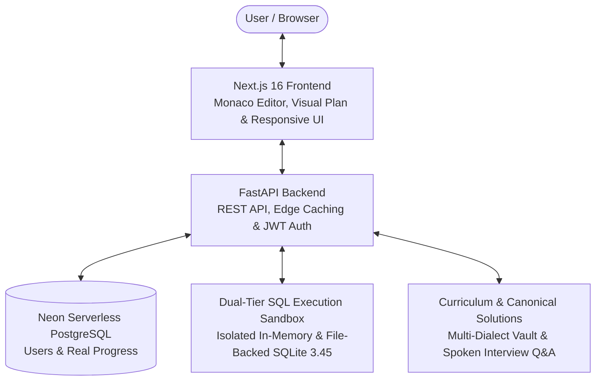

# ⚡ SQL Quest — 100 Relational Database & SQL Masterclass Platform

[](https://sql_quest17.vercel.app)
[](https://sql-quest-backend.vercel.app/health)
[](https://nextjs.org/)
[](https://react.dev/)
[](https://fastapi.tiangolo.com/)
[](https://sqlite.org/)
[](LICENSE)

**SQL Quest** is an interactive, precision-machined engineering workspace designed to help developers master essential SQL queries, relational joins, subqueries, CTEs, and window functions for technical database interviews.

---

## 🌐 Live Hosted Deployment

The platform is fully deployed and available online:

| Service | Endpoint | Description |
| :--- | :--- | :--- |
| **Frontend Web App** | [https://sql_quest17.vercel.app](https://sql_quest17.vercel.app) | Production Next.js 16 UI with Monaco SQL Editor |
| **Backend REST API** | [https://sql-quest-backend.vercel.app](https://sql-quest-backend.vercel.app) | High-performance FastAPI serverless engine |
| **Interactive API Docs** | [https://sql-quest-backend.vercel.app/docs](https://sql-quest-backend.vercel.app/docs) | Swagger UI for exploring and testing API endpoints |
| **Health Check** | [https://sql-quest-backend.vercel.app/health](https://sql-quest-backend.vercel.app/health) | Live backend and Neon database connectivity telemetry |

---

## 🔗 Quick Start & Local Execution

### 1. Environment Configuration
```bash
cp .env.example .env
```

### 2. Start Services
Start both the FastAPI backend (port `8000`) and Next.js frontend (port `3000`) with a single command:

```bash
./run.sh
```

Or run each service individually:

### Backend
```bash
cd backend
python3 -m venv venv && source venv/bin/activate
pip install -r requirements.txt
uvicorn app.main:app --reload --port 8000
```

### Frontend
```bash
cd frontend
npm install
npm run dev
```

---

## 📐 Architecture & System Design



### Architectural Highlights
- **Next.js 16 & React 19**: Ultra-fast SSR and client-side state management, Monaco code editor, global keyboard shortcuts (`Ctrl+Enter` / `Cmd+Enter`), responsive mobile workspace drawer, and dark terminal aesthetics.
- **Visual Query Execution Plan**: Real-time `EXPLAIN QUERY PLAN` tree visualizer identifying sequential scans (`SCAN`), temporary B-trees (`USE TEMP B-TREE`), and indexed searches (`USING INDEX`) with algorithmic efficiency classifications (Optimal, Memory Sort, Sequential Scan).
- **FastAPI Backend & Async Engine**: Asynchronous endpoints with Pydantic validation, bcrypt password hashing in thread pools, and Neon serverless PostgreSQL integration.
- **Dual-Tier Resilient Session Sandbox**: Dual-layer storage (in-memory dictionary + atomic file-based persistence) ensuring custom user schemas (`schema.sql`) and tables survive serverless cold starts.
- **Anti-Cheat & Hardened Evaluation**: Rejects hardcoded `UNION ALL` literal bypasses without table references; features deep multiset matching and date/time format normalization (`YYYY-MM-DD`).
- **Seamless Guest-to-Cloud Migration**: Zero-data-loss synchronization of client-side solved problems and execution telemetry into permanent cloud accounts upon login or registration.
- **Multi-Dialect Solution Vault**: Comprehensive mental models, logical execution orders, beginner traps, complexity benchmarks, and instant cross-dialect translations (SQLite, PostgreSQL, MySQL, Snowflake).

---

## 📁 Folder Structure

```text
Study/
├── frontend/                  # Next.js 16 Web Application
│   ├── src/
│   │   ├── app/              # App Router (Dashboard, Curriculum, Quest Workspace, Profile, Admin)
│   │   ├── components/       # UI Components (Monaco, SchemaViewer, QueryPlanViewer, InterviewPanel)
│   │   ├── hooks/            # Custom React Hooks & Shortcuts
│   │   └── lib/              # API Client, Auth Context, Persistence, Dialects & Problem Data
│   ├── public/               # Static Assets & Icons
│   ├── next.config.ts        # Next.js & Turbopack Configuration
│   └── package.json
│
├── backend/                   # FastAPI Backend Service
│   ├── api/                  # Vercel Serverless Entry Point (index.py)
│   ├── app/
│   │   ├── routers/          # API Route Handlers (auth, challenges, execution, profile, admin)
│   │   ├── sandbox/          # SQLite Sandbox Engine, Schema Manager & Test Evaluator
│   │   ├── database.py       # Neon PostgreSQL / SQLite async engine
│   │   ├── models.py         # SQLAlchemy ORM Models
│   │   ├── schemas.py        # Pydantic Schemas & Validations
│   │   ├── security.py       # JWT & Async Bcrypt Cryptography
│   │   ├── cache.py          # Hot In-Memory Curriculum & Telemetry Cache
│   │   └── main.py           # FastAPI Application Entry Point & CORS Setup
│   ├── tests/                # Pytest Backend Unit & Integration Tests (16 Passing)
│   ├── vercel.json           # Vercel Python Builder Configuration
│   └── requirements.txt      # Backend Dependencies
│
├── .env.example               # Environment Variables Template
├── requirements.txt           # Root Python Dependencies
└── run.sh                     # Unified Local Dev Startup Script
```

---

## 🌟 Key Features

- 🎯 **100 Curated Relational SQL Challenges**: Structured progressively across Projections, Aggregates, GROUP BY, Having, Joins, Self-Joins, Subqueries, Window Functions, and CTEs.
- 🌳 **Interactive Query Plan Visualizer**: Inspect query tree operations (`EXPLAIN QUERY PLAN`) with visual badges for sequential scans, temp B-trees, and optimal index lookups.
- 🌐 **Cross-Dialect SQL Translation**: Side-by-side SQL translations across SQLite, PostgreSQL, MySQL, and Snowflake in the Solution Vault.
- 🧠 **Intuitive Mental Models & Line-by-Line Breakdowns**: Step-by-step query execution pipelines, logical execution orders, and common beginner pitfalls.
- 🎙️ **Spoken Interview Q&As**: Real interview follow-ups comparing alternative approaches (e.g., correlated subqueries vs. joins vs. window functions).
- ⚡ **Instant In-Browser Sandbox**: Real SQLite execution with live column/row output grids, runtime telemetry, and auto-test verification.
- 🔄 **Guest-to-Cloud Automatic Sync**: Guest study sessions and local drafts seamlessly migrate to authenticated accounts upon sign-in.
- 🔥 **Daily Practice Streak & Telemetry**: Dynamic streak tracking based on real submission timestamps, acceptance rates, and benchmark metrics.

---

## 🛠️ Tech Stack

- **Frontend**: Next.js 16, React 19, Tailwind CSS 4, Monaco Editor, Lucide Icons, Canvas Confetti
- **Backend**: Python 3.14, FastAPI, SQLAlchemy 2.0 (Async), Pydantic v2
- **Database**: Neon Serverless PostgreSQL (Production) / SQLite 3.45 (Local & Execution Sandbox)
- **Deployment**: Vercel (Frontend & Python Serverless Functions)
- **Testing**: Pytest (16 automated tests passing) & Next.js Turbopack verification

