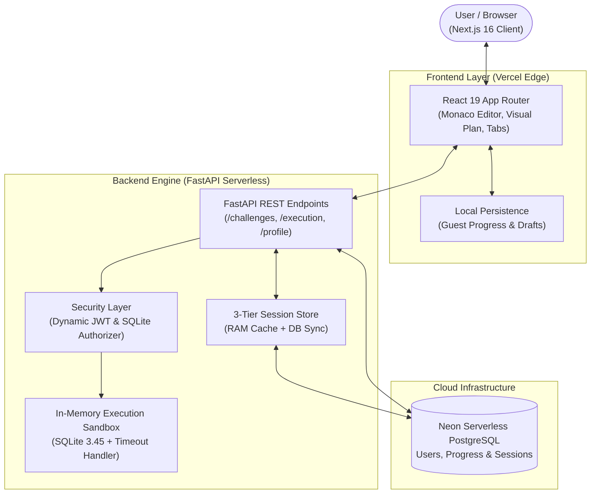

# ⚡ SQL Quest — 100 Relational Database & SQL Masterclass Platform

<div align="center">

[](https://github.com/Spidey173/SQL-Quest/actions/workflows/ci.yml)
[](https://sqlquest17.vercel.app)
[](https://sql-quest-backend.vercel.app/health)
[](LICENSE)

<br />

[](https://nextjs.org/)
[](https://react.dev/)
[](https://fastapi.tiangolo.com/)
[](https://www.typescriptlang.org/)
[](https://python.org/)
[](https://sqlite.org/)
[](https://neon.tech/)

<p align="center">
  <strong>SQL Quest</strong> is an interactive engineering workspace designed to master essential SQL queries, relational joins, subqueries, CTEs, and window functions for technical database interviews.
</p>

[**Explore Live Demo**](https://sqlquest17.vercel.app) • [**Interactive API Docs**](https://sql-quest-backend.vercel.app/docs) • [**Curriculum**](https://sqlquest17.vercel.app/quest) • [**Telemetry**](https://sqlquest17.vercel.app/profile)

</div>

---

## 🌐 Live Hosted Deployment

The platform is deployed globally on Vercel with serverless backend compute and Neon PostgreSQL:

| Service | Endpoint | Description | Status |
| :--- | :--- | :--- | :--- |
| **Frontend Web App** | [`sqlquest17.vercel.app`](https://sqlquest17.vercel.app) | Production Next.js 16 UI with Monaco SQL Editor | Active |
| **Backend REST API** | [`sql-quest-backend.vercel.app`](https://sql-quest-backend.vercel.app) | High-performance FastAPI serverless engine | Active |
| **Interactive API Docs** | [`/docs`](https://sql-quest-backend.vercel.app/docs) | OpenAPI 3.1 / Swagger UI explorer | Active |
| **Health Telemetry** | [`/health`](https://sql-quest-backend.vercel.app/health) | Live backend and Neon database health status | Active |

---

## 🌟 Key Capabilities

* 🎯 **100 Progressive SQL Interview Challenges**: Structured across Projections, Filtering, Aggregates, `GROUP BY`, `HAVING`, Joins, Self-Joins, Subqueries, Window Functions (`DENSE_RANK`, `LEAD`, `LAG`), and Recursive CTEs.
* 🛡️ **Hardened Execution Sandbox**:
  * **SQLite Security Authorizer**: Enforces engine-level access control denying `ATTACH DATABASE`, `DETACH DATABASE`, and dangerous `PRAGMA` operations.
  * **Execution Timeout Handler**: Guards against infinite recursive CTEs and Cartesian loops via `conn.set_progress_handler` (3.0s deadline).
  * **Memory & Output Capping**: Limits row fetching to 500 rows (`cursor.fetchmany`) and caps output buffers at 64KB to prevent server Out-Of-Memory crashes.
* 🌳 **Interactive Query Execution Plan**: Visualizes SQLite `EXPLAIN QUERY PLAN` trees, categorizing operations as **Optimal** (`INDEX_SEARCH`), **Memory Sort** (`TEMP_B_TREE`), or **Sequential Scan** (`FULL_TABLE_SCAN`).
* ⚡ **3-Tier Serverless State Persistence**:
  * **Tier 1 (RAM)**: Sub-millisecond in-process cache.
  * **Tier 2 (PostgreSQL Database)**: Shared `sandbox_sessions` table syncing user schemas across ephemeral Vercel serverless workers and cold starts.
  * **Tier 3 (Local Temp Files)**: Ephemeral filesystem fallback for offline development.
* 🌐 **Cross-Dialect Solution Vault**: Instant translation across **SQLite**, **PostgreSQL**, **MySQL**, and **Snowflake** with logical execution breakdowns and interview trade-offs.
* 📈 **Daily Velocity & Practice Telemetry**: Dynamic activity timeline with intelligent range auto-detection (`14D`, `30D`, `60D`, `90D`), smart scroll centering on active days, and streak cadence.
* 🔄 **Guest-to-Cloud Automatic Sync**: Guest study sessions and local drafts seamlessly migrate to authenticated accounts upon sign-in.

---

## 📐 Architecture & System Design



---

## 🚀 Quick Start & Local Development

### Prerequisites
* **Node.js** `>= 20.x` & **npm**
* **Python** `>= 3.12` & **pip**

### 1. Clone the Repository
```bash
git clone https://github.com/Spidey173/SQL-Quest.git
cd SQL-Quest
```

### 2. Environment Setup
```bash
cp .env.example .env
```
*(By default, the backend falls back to local SQLite if `DATABASE_URL` is omitted, and provisions a secure dynamic secret key).*

### 3. One-Command Startup
Launch both the backend (port `8000`) and frontend (port `3000`) concurrently:
```bash
chmod +x run.sh
./run.sh
```

---

### Manual Service Startup

#### Backend (FastAPI)
```bash
cd backend
python3 -m venv venv
source venv/bin/activate
pip install -r requirements.txt
uvicorn app.main:app --reload --port 8000
```
* Interactive Docs: `http://localhost:8000/api/docs`
* Health Check: `http://localhost:8000/api/health`

#### Frontend (Next.js 16)
```bash
cd frontend
npm install
npm run dev
```
* App URL: `http://localhost:3000`

---

## 🧪 Testing & Continuous Integration

This repository runs automated CI checks on every push and pull request via GitHub Actions:

```text
GitHub Actions CI Pipeline:
├── Backend Tests (Python 3.12, Pytest, 16 test cases, SQLite mock DB)
└── Frontend Quality (Node.js 20, TypeScript tsc --noEmit, ESLint)
```

### Running Tests Locally

#### Backend Tests (Pytest)
```bash
DATABASE_URL="sqlite:///./test_ci.db" pytest backend/tests -v
```

#### Frontend Typecheck & Linter
```bash
# TypeScript verification
npm --prefix frontend run typecheck

# Code quality & hooks purity
npm --prefix frontend run lint
```

---

## 📁 Repository Structure

```text
SQL-Quest/
├── .github/
│   └── workflows/
│       └── ci.yml             # GitHub Actions CI Workflow (Backend Pytest + Frontend Typecheck)
│
├── frontend/                  # Next.js 16 Web Application
│   ├── src/
│   │   ├── app/              # App Router (Dashboard, Curriculum, Quest Workspace, Profile, Admin)
│   │   ├── components/       # Monaco Editor, SchemaViewer, QueryPlanViewer, InterviewPanel
│   │   ├── hooks/            # Keyboard Shortcuts & State Hooks
│   │   └── lib/              # API Client, Persistence, Auth Context, Types
│   ├── public/               # Static Logos & Icons
│   ├── next.config.ts        # Next.js & Turbopack Configuration
│   ├── tsconfig.json         # TypeScript Compiler Configuration
│   └── package.json
│
├── backend/                   # FastAPI Backend Service
│   ├── api/
│   │   └── index.py          # Vercel Serverless Entry Point
│   ├── app/
│   │   ├── routers/          # Route Controllers (auth, challenges, execution, profile, admin)
│   │   ├── sandbox/          # SQLite Sandbox Engine, Schema Manager & Authorizer
│   │   ├── config.py         # App Configuration & Dynamic JWT Cryptography
│   │   ├── database.py       # Async SQLAlchemy Engine & Session Factory
│   │   ├── models.py         # ORM Models (User, Challenge, UserProgress, Submission, SandboxSession)
│   │   ├── schemas.py        # Pydantic Schemas & DTOs
│   │   ├── security.py       # Password Hashing & JWT Verification
│   │   └── main.py           # FastAPI Application Entry & CORS Setup
│   ├── tests/                # Automated Pytest Suite (16 Test Cases)
│   ├── vercel.json           # Vercel Deployment Configuration
│   └── requirements.txt      # Python Dependencies
│
├── .env.example               # Environment Variables Template
├── requirements.txt           # Top-Level Python Dependencies
└── run.sh                     # Unified Startup Shell Script
```

---

## 🛡️ Sandbox Security Architecture

Running arbitrary user-submitted SQL queries requires defense-in-depth:

```text
Incoming SQL Request
   │
   ├── 1. Static Pattern Safety Validation (DANGEROUS_SQL_PATTERNS)
   ├── 2. Query Comment Stripping & Quote-Aware Tokenizer (split_sql_statements)
   ├── 3. Engine SQLite Authorizer (Blocks ATTACH, DETACH, PRAGMA)
   ├── 4. Progress Handler Timeout (3.0s Deadline via sqlite3.set_progress_handler)
   ├── 5. Capped Row Extraction (cursor.fetchmany(500) prevents memory spikes)
   └── 6. Output Buffer Limiter (Enforces 64KB max byte threshold)
```

---

## 📄 License

This project is open-source under the [MIT License](LICENSE).
